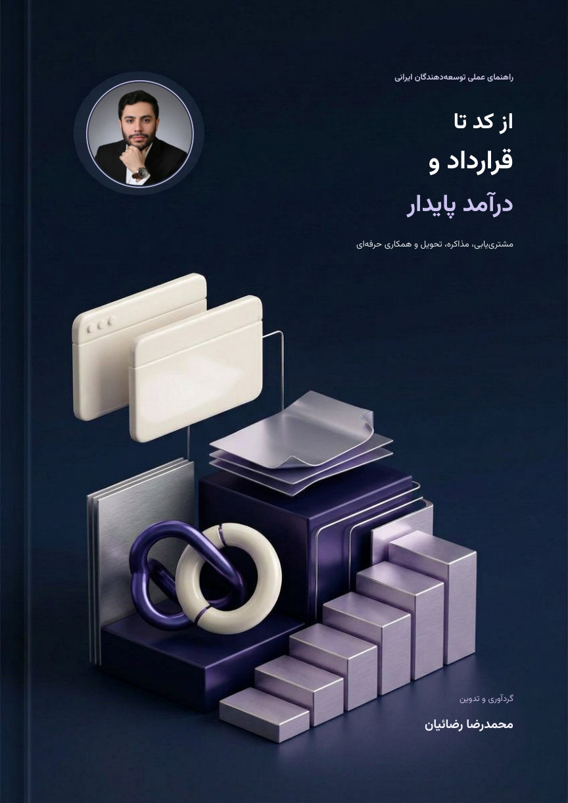

<div align="center" dir="rtl">

# 🌉 Dev Bridge

### از کد تا قرارداد و درآمد پایدار

**راهنمای عملی همکاری حرفه‌ای بین‌المللی برای توسعه‌دهندگان ایرانی**

گردآوری و تدوین: **محمدرضا رضائیان**

<a href="docs/pdf/guide-fa.pdf"></a>

[📕 دریافت PDF](docs/pdf/guide-fa.pdf) &nbsp; · &nbsp; [🌐 مطالعهٔ آنلاین](https://rezaian-dev.github.io/dev-bridge/) &nbsp; · &nbsp; [🧭 فهرست راهنما](https://rezaian-dev.github.io/dev-bridge/#chapters)

</div>

---

<div dir="rtl">

## مسیر حرفه‌ای، با تصمیم‌های روشن‌تر

مهارت فنی نقطهٔ شروع است؛ یک همکاری موفق به **شناخت مسئله، توافق شفاف و تحویل قابل‌اعتماد** هم نیاز دارد. این راهنما کمک می‌کند از اولین گفت‌وگو تا پایان پروژه، انتخاب‌هایتان را آگاهانه‌تر و مکتوب‌تر پیش ببرید.

**۳۰ فصل و پیوست** · **۵۵ صفحه PDF** · **۱۷ منبع** · **مطالعه در موبایل و دسکتاپ**

## چه چیزی در راهنما پیدا می‌کنید؟

| گام | آنچه یاد می‌گیرید |
| :--- | :--- |
| 🎯 **پیدا کردن مسیر** | جایگاه‌یابی، نمونه‌کار، مشتری‌یابی و ارزیابی فرصت‌ها |
| 💬 **رسیدن به توافق** | کشف نیاز، تعیین محدوده، تخمین، پیشنهاد و مذاکره |
| 📝 **محافظت از همکاری** | قرارداد، تغییرات، مالکیت فکری، حریم خصوصی و ریسک |
| 🚀 **تحویل حرفه‌ای** | مدیریت پروژه، کیفیت، دریافت وجه و بستن همکاری |
| 🧰 **ابزارهای آماده** | الگوهای پیشنهاد، درخواست تغییر، فاکتور و چک‌لیست‌ها |

## از کجا شروع کنم؟

**اگر می‌خواهید از ابتدا جلو بروید:** [پیش از شروع و نقشهٔ راه](https://rezaian-dev.github.io/dev-bridge/chapters/00-start.html) را بخوانید.

**اگر در حال صحبت با مشتری هستید:** سراغ [کشف نیاز](https://rezaian-dev.github.io/dev-bridge/chapters/06-qualify.html)، [تعیین محدوده](https://rezaian-dev.github.io/dev-bridge/chapters/07-scope.html) و [پیشنهاد تجاری](https://rezaian-dev.github.io/dev-bridge/chapters/09-proposal.html) بروید.

**اگر برای اجرا آماده می‌شوید:** [قرارداد](https://rezaian-dev.github.io/dev-bridge/chapters/10-contract.html)، [تحویل](https://rezaian-dev.github.io/dev-bridge/chapters/14-delivery.html) و [چک‌لیست نهایی](https://rezaian-dev.github.io/dev-bridge/chapters/28-final-check.html) را ببینید.

## دو راه برای مطالعه

| 📕 نسخهٔ PDF | 🌐 نسخهٔ آنلاین |
| :--- | :--- |
| صفحه‌آرایی ثابت، مناسب مطالعه و چاپ، با فهرست پیونددار | جست‌وجوی فصل‌ها، محاسبه‌گر و نمایش واکنش‌گرا |
| [دریافت فایل PDF](docs/pdf/guide-fa.pdf) | [ورود به راهنمای آنلاین](https://rezaian-dev.github.io/dev-bridge/) |

> **نکتهٔ مهم:** این راهنما آموزش عمومی است، نه مشاورهٔ حقوقی، مالیاتی، بانکی، مهاجرتی یا تحریمی. پیش از تصمیم واقعی، وضعیت خود را با متخصص صلاحیت‌دار و منابع رسمی روز بررسی کنید.

[مشاهدهٔ منابع و روش بررسی](https://rezaian-dev.github.io/dev-bridge/sources.html) · [دسترسی به PDF در مخزن](docs/pdf/guide-fa.pdf)

</div>

---

<details>
<summary>اطلاعیه‌های حقوقی و منابع نرم‌افزاری ضروری</summary>

<div dir="rtl">

# مجوز محتوای آموزشی

پیشنهاد اولیه برای **متن‌های اصلی، الگوها و دارایی‌های گرافیکیِ ساخته‌شده برای این پروژه**: **Creative Commons Attribution-NonCommercial-ShareAlike 4.0 International (CC BY-NC-SA 4.0)**.

متن کامل مجوز: <https://creativecommons.org/licenses/by-nc-sa/4.0/legalcode>

به‌طور خلاصه، بازنشر و اقتباس با انتساب مناسب، استفاده‌ی غیرتجاری و انتشار اقتباس تحت همان مجوز مجاز است؛ شرایط کامل قانونی، استثناها و تعریف «غیرتجاری» را در متن رسمی بخوانید. این خلاصه جای متن مجوز نیست. این پیشنهاد فقط درباره‌ی آثاری است که صاحب آن‌ها حق اعطای مجوز دارد؛ مالک پروژه پیش از انتشار عمومی باید آن را تأیید کند.

## استثناها و دارایی‌های دارای مجوز جداگانه

- **پرتره‌ی انتخاب‌شده توسط کاربر** در `docs/assets/images/profile-business.jpg` و برش دایره‌ای مشتق‌شده در `docs/assets/images/profile-avatar.png` و جلد ترکیبی `docs/assets/images/ebook-cover.jpg` (و جلدهای حاوی همین پرتره در PDF و EPUB) فقط در این پروژه به کار رفته‌اند؛ بنا بر این اطلاعیه تحت CC BY-NC-SA یا مجوز باز دیگری قرار نمی‌گیرند. بازنشر/استفاده‌ی مجدد به مجوز جداگانه‌ی صاحب حق نیاز دارد. نام یا هویت دیگری برای شخص داخل تصویر ساخته نشده است.
- تصویرهای سه‌بعدی جلد `docs/assets/images/cover-3d-art.jpg` و `docs/assets/images/cover-3d-plum.jpg`، تصویر جلد قبلی `docs/assets/images/book-cover-art.jpg` و سه تصویر مفهومی راهنما (`project-roadmap.jpg`، `client-pipeline.jpg`، `frontend-quality.jpg`) دارایی‌های ساخته‌شده برای پروژه‌اند و در پیشنهاد CC BY-NC-SA بالا قرار می‌گیرند.
- فونت Vazirmatn تحت SIL OFL است؛ متن کامل در `docs/assets/fonts/OFL.txt` و اطلاعیه‌های زیر آمده است.
- کد ابزارها تحت مجوز MIT مندرج در ادامه است.

اگر پروژه به‌صورت عمومی منتشر شود، فایل‌های عکس همراه مخزن در دسترس عموم قرار می‌گیرند؛ پیش از push عمومی، رضایت و دامنه‌ی انتشار را بررسی کنید. این فایل مجوز حقوقی هر دارایی ثالث نیست.

</div>

### Code license

```text
MIT License

Copyright (c) 2026 Contributors

Permission is hereby granted, free of charge, to any person obtaining a copy
of this software and associated documentation files (the "Software"), to deal
in the Software without restriction, including without limitation the rights
to use, copy, modify, merge, publish, distribute, sublicense, and/or sell
copies of the Software, and to permit persons to whom the Software is
furnished to do so, subject to the following conditions:

The above copyright notice and this permission notice shall be included in all
copies or substantial portions of the Software.

THE SOFTWARE IS PROVIDED "AS IS", WITHOUT WARRANTY OF ANY KIND, EXPRESS OR
IMPLIED, INCLUDING BUT NOT LIMITED TO THE WARRANTIES OF MERCHANTABILITY,
FITNESS FOR A PARTICULAR PURPOSE AND NONINFRINGEMENT. IN NO EVENT SHALL THE
AUTHORS OR COPYRIGHT HOLDERS BE LIABLE FOR ANY CLAIM, DAMAGES OR OTHER
LIABILITY, WHETHER IN AN ACTION OF CONTRACT, TORT OR OTHERWISE, ARISING FROM,
OUT OF OR IN CONNECTION WITH THE SOFTWARE OR THE USE OR OTHER DEALINGS IN THE
SOFTWARE.
```

### Third-party notices

```text
Vazirmatn variable font
Copyright 2015 The Vazirmatn Project Authors (https://github.com/rastikerdar/vazirmatn)

This Font Software is licensed under the SIL Open Font License, Version 1.1.
The complete license text is in docs/assets/fonts/OFL.txt and at:
https://openfontlicense.org/open-font-license-official-text/

This font family is bundled for local Persian text rendering. `Vazirmatn-Bold.woff2` is a static 700-weight instance generated from the bundled variable font for PDF rendering; both font files remain under the SIL OFL. The content license does not override the font license.

User-selected portrait assets

At the user's direction, `docs/assets/images/profile-business.jpg` is used as the portrait source and `profile-avatar.png` is a circular crop derived from it. `ebook-cover.jpg` and the PDF cover incorporate this portrait and inherit this restriction. Both portrait files are excluded from the CC BY-NC-SA content-license proposal and are not granted an open license by this notice. Do not reuse or redistribute them outside the scope authorized by the rights holder.

The generated `book-cover-art.jpg`, `cover-3d-art.jpg` and `cover-3d-plum.jpg` are original background artwork for this project and are included with the project graphics under the content-license proposal. None of these backgrounds contains a portrait; the portrait is overlaid separately.
```

اطلاعیه‌های کامل کتابخانه‌ها و فونت‌های شخص ثالث در پوشهٔ `docs/assets` حفظ شده‌اند.

</details>

<div align="center" dir="rtl">

**برای یادگیری دقیق‌تر، تصمیم‌گیری آگاهانه‌تر و همکاری حرفه‌ای‌تر.**

</div>
